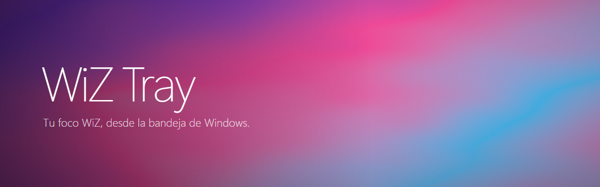
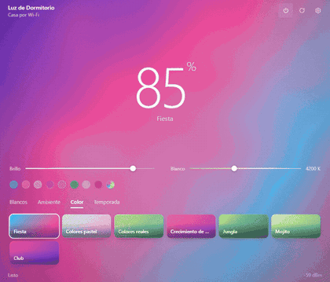
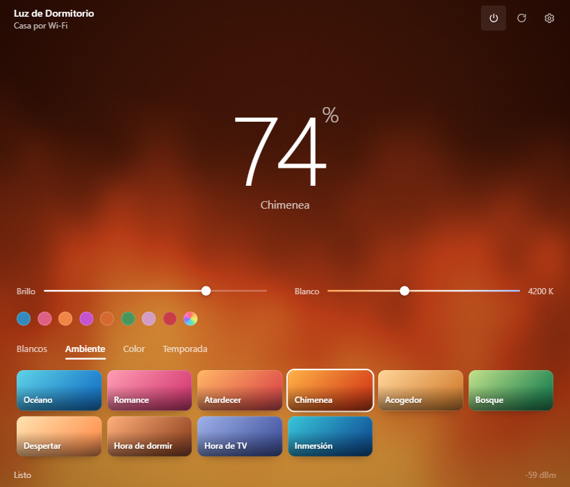
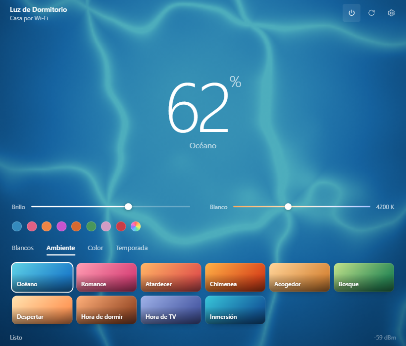
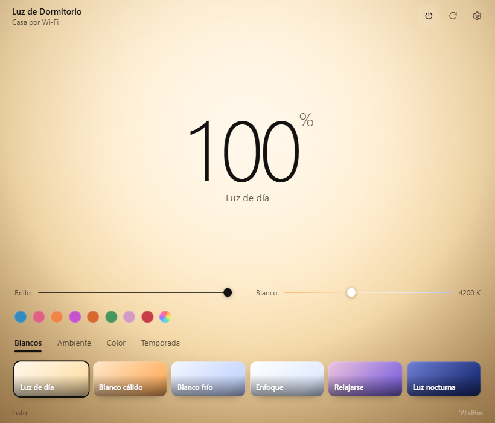
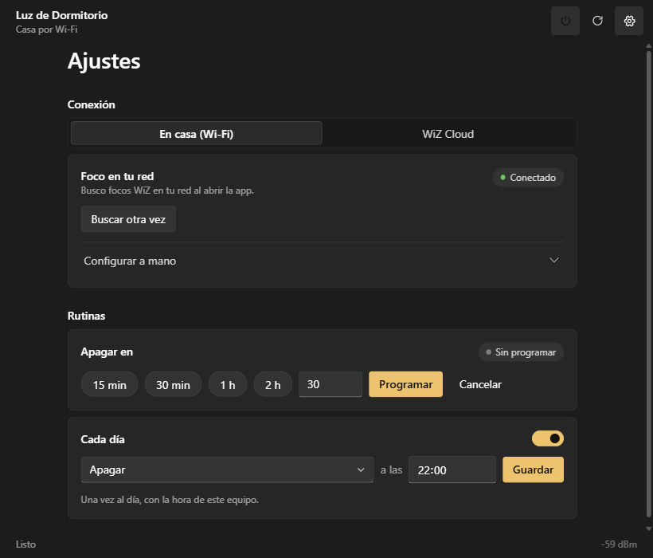

<div align="center">
  

  <p>
    
    
    
    
  </p>

  <p>Controla tu foco WiZ desde la bandeja de Windows.<br>
  La ventana se ilumina con la luz real del foco.</p>
</div>

<br>

<p align="center">
  
</p>

## La luz es la interfaz

Al abrir WiZ Tray ves lo que hace tu foco. Un shader WebGPU pinta la ventana con la escena activa, y cada escena tiene su paleta y su movimiento: Océano proyecta cáusticas, Chimenea sube como una llama, Romance late. Las escenas que en WiZ son fijas, como Luz de día o Luz nocturna, quedan quietas.

| | | |
|:-:|:-:|:-:|
|  |  |  |
| Chimenea | Océano | Luz de día |

- **Arrastra** sobre la luz para cambiar el brillo y **haz clic** para encender o apagar. La luz se abre desde el punto que tocaste.
- **Brillo y Blanco** son dos líneas finas, de 1 a 100 % y de 2200 a 6500 K.
- **8 colores rápidos** y un selector libre para cualquier otro color.
- **Las 28 escenas** de WiZ están en recuadros con su paleta, en cuatro pestañas: Blancos, Ambiente, Color y Temporada.
- **Desde la bandeja** puedes abrir la ventana, encender, apagar o poner Luz de día sin abrir nada.

## Ajustes



**Conexión.** En casa, la app busca tus focos al abrirse, sin cuenta ni internet. Si el router le da otra IP al foco, lo vuelve a encontrar. Fuera de casa puedes usar WiZ Cloud.

**Rutinas.** Apagado tras 15 min, 30 min, 1 h, 2 h o los minutos que elijas, y una acción diaria a una hora fija.

La ventana usa Mica en Windows 11, sigue las transiciones de Fluent y respeta la opción de reducir animaciones de Windows.

<br clear="right">

## Instalación

Necesitas Windows 10 u 11 de 64 bits y Docker Desktop con Compose.

```powershell
git clone https://github.com/dbqp01/wiz-tray.git
cd wiz-tray
docker compose run --build --rm build
.\dist\WiZ Tray.exe
```

El build deja el ejecutable en `dist/WiZ Tray.exe`; la app no corre dentro del contenedor. Al cerrar la ventana, WiZ Tray sigue en la bandeja. Para cerrarla del todo, usa **Salir** en el menú del icono.

## Conectar el foco

<details>
<summary><b>En casa, por Wi-Fi</b> (recomendado)</summary>
<br>

1. En la app WiZ, activa **Ajustes → Seguridad → Comunicación local**.
2. Abre WiZ Tray. Si hay un solo foco en tu red, queda configurado solo. Si hay varios, elige uno en **Ajustes → Conexión**.
3. El equipo y el foco deben estar en la misma red Wi-Fi.

Algunos firmwares nuevos exigen comandos firmados. En ese caso, elige el export `wiz-home.json` de la app WiZ en **Ajustes → WiZ Cloud → paso 1**: la app lee la clave en tu equipo y firma los comandos.

</details>

<details>
<summary><b>Fuera de casa, con WiZ Cloud</b></summary>
<br>

**Ajustes → WiZ Cloud** te guía en tres pasos que se marcan al completarse:

1. **Elige el export de la app WiZ.** Rellena el foco, el hogar, la MAC y el rango de blanco.
2. **Guarda las credenciales OAuth de la app WiZ.** Se cifran con Windows DPAPI y no se vuelven a mostrar.
3. **Inicia sesión con Google.** Se abre el navegador y, al volver, la app ya controla el foco.

> [!IMPORTANT]
> Este repo no incluye las credenciales OAuth de la app WiZ, y las de Google no las sustituyen. Un clon limpio no completa Cloud hasta que tengas esas credenciales por una vía autorizada. Para instalaciones profesionales existe la [API documentada de WiZ Pro](https://docs.pro.wizconnected.com/), que es otra ruta.

El equipo debe seguir encendido, con internet y con WiZ Tray en la bandeja.

</details>

## Si algo falla

| Síntoma | Qué probar |
|---|---|
| No encuentra el foco | Comprueba que ambos están en la misma Wi-Fi y que el firewall permite UDP 38899. También puedes escribir IP y MAC en **Ajustes → Configurar a mano** |
| El foco ignora los comandos | Su firmware exige firma: elige `wiz-home.json` en **Ajustes → WiZ Cloud → paso 1** |
| `redirect_uri_mismatch` al iniciar sesión | El cliente OAuth de Google debe ser de tipo **App de escritorio** |
| `invalid_client` | Client ID o secreto incorrectos: vuelve a guardarlos |
| `access_denied` | Añade tu cuenta como usuario de prueba en la pantalla de consentimiento |
| Cloud muestra un estado viejo | Cloud se consulta cada minuto; revisa la sesión y que el equipo no esté suspendido |
| La luz no se mueve | Sin WebGPU la app usa un degradado fijo. Revisa los controladores de vídeo o la opción de reducir animaciones de Windows |

## Privacidad

- La app habla directamente con el foco o con WiZ Cloud, sin servidores intermedios.
- El export `wiz-home.json` contiene una clave privada. WiZ Tray guarda solo la ruta y lee la clave en tu equipo.
- Las credenciales OAuth y el refresh token se cifran con **Windows DPAPI** en tu perfil.
- Nada de eso se sube al repositorio ni se escribe en logs. No pegues secretos en issues ni en chats.

## Desarrollo

```powershell
# Reproducible con Docker: pruebas contra un foco simulado y .exe de Windows
docker compose run --build --rm build

# En Windows, con Rust estable, rustfmt y WinLibs POSIX UCRT
rustup target add x86_64-pc-windows-gnu
rustup component add rustfmt
.\build.ps1

# La app con interfaz y backend reales
cd src-tauri
cargo run
```

| Ruta | Qué hay |
|---|---|
| [`ui/`](ui) | La interfaz: HTML, CSS y JavaScript planos, sin npm ni bundler |
| [`ui/light.js`](ui/light.js) | El shader WebGPU con las paletas y los bucles de las 28 escenas |
| [`src-tauri/`](src-tauri) | La app Tauri 2: bandeja, ventana, sondeo del foco y comandos |
| [`src/`](src) | El núcleo: protocolo local, WiZ Cloud, OAuth y DPAPI |
| [`docs/design-previews/`](docs/design-previews) | Maquetas del rediseño y el prototipo WebGPU |

La interfaz se compila dentro del `.exe`: si tocas `ui/`, vuelve a compilar para ver el cambio. Puedes abrir `ui/index.html` en un navegador para revisar el diseño en modo demo.

Ninguno de los dos builds prueba una bombilla física, el login real de WiZ Cloud ni una cuenta de Google. Antes de tocar código, lee [AGENTS.md](AGENTS.md).

---

<div align="center">
  <sub>WiZ Tray no está afiliado a WiZ ni a Signify.</sub>
</div>
