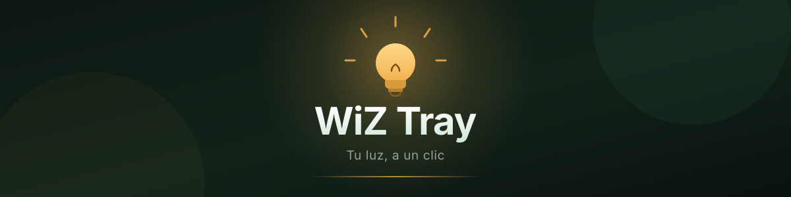

<div align="center">
  

  <p>
    
    
    
    
  </p>

  <p>Panel y bandeja para focos WiZ en Windows.<br>
  Local primero; Cloud si lo necesitas.</p>
</div>

---

## ✨ Qué incluye

| | |
|---|---|
| 💡 **Panel** | Un foquito que se enciende con el color real de tu foco: brillo, temperatura y 8 colores |
| 🎭 **Escenas** | Seis favoritas a la vista y 28 en total, incluidas Fiesta y Halloween |
| ⏱️ **Rutinas** | Apagado tras un intervalo o acción diaria a una hora local |
| 🖥️ **Bandeja** | Abre el panel o enciende, apaga y pone Luz de día desde el icono |
| 🔌 **Dos modos** | Local por Wi-Fi (UDP 38899) o WiZ Cloud; puedes guardar ambos y alternar |

> [!NOTE]
> Algunos modos dependen del modelo de foco. Las animaciones del panel se desactivan si Windows tiene las animaciones apagadas.

## 🎨 La interfaz

El panel es una app web ligera dentro de una ventana de Tauri (`ui/`, sin Node ni bundler): HTML, CSS y JavaScript planos que Rust alimenta por comandos.

- **El foquito es la escena activa.** Toma el color, la temperatura y el brillo que lee del foco, y la ventana entera se tiñe con esa luz: azul si el foco está en Blanco frío, ámbar si está en Luz de día.
- **Cuatro pestañas, el mismo foquito arriba:** Inicio (diales, colores y ficha del foco), Escenas, Rutinas y Conexiones.
- **Respeta el sistema:** si Windows tiene las animaciones apagadas, la respiración del foquito y los pulsos de escena se detienen.

El código de la interfaz vive en [`ui/`](ui): `index.html`, `app.css` y `app.js`. Rust expone los comandos en [`src-tauri/src/appstate.rs`](src-tauri/src/appstate.rs).

## 🧭 Cómo funciona

La app corre en tu equipo y habla directo con el foco o con WiZ Cloud. No hay servidor propio en medio.

- **Local**: comandos UDP 38899 dentro de tu red. Sin cuenta ni internet. El token de firma es opcional.
- **Cloud**: OAuth con Google y credenciales de WiZ. La app refresca el estado cada 4 segundos en local y cada minuto en Cloud.

## 🚀 Instalación

Windows 10/11 de 64 bits + Docker Desktop con Compose:

```powershell
git clone https://github.com/dbqp01/wiz-tray.git
cd wiz-tray
docker compose run --build --rm build
.\dist\WiZ Tray.exe
```

El build deja el ejecutable en `dist/WiZ Tray.exe`; la app no corre dentro del contenedor. Al cerrar la ventana queda en la bandeja: usa **Salir de WiZ Tray** en el menú del icono para cerrarla del todo.

## 🔧 Conexiones

Abre **Conexiones** en el primer inicio y configura uno o ambos modos.

<details>
<summary><b>🏠 Control local</b> (recomendado en casa)</summary>

1. En la app WiZ: **Ajustes → Seguridad → comunicación local**.
2. En WiZ Tray: **Conexiones → Local → Buscar focos en mi red**. Escanea tu subred `/24` por UDP 38899 y muestra IP + MAC; **Usar y conectar** guarda al instante. También puedes escribir IP y MAC a mano.
3. El **token es opcional**. Con el export `wiz-home.json` la app firma por HMAC; sin él envía JSON sin firma. Muchos firmwares domésticos lo aceptan (probado en un foco real); otros más nuevos lo rechazan y entonces hace falta el export.
4. Equipo y foco deben estar en la misma red Wi-Fi.

</details>

<details>
<summary><b>☁️ WiZ Cloud</b> (control remoto)</summary>

1. Sigue el asistente **Foco → Acceso → Conectar**. Busca la MAC automáticamente en tu Wi-Fi y elige el foco encontrado. Si falla, abre **No aparece · Ayuda desde el móvil**. Importa un export compatible o escribe los IDs del foco y del hogar: la búsqueda local solo obtiene la MAC.
2. Añade el Client ID de Google y las credenciales OAuth privadas de WiZ. El secreto de Google es opcional; el Client ID y el secreto de WiZ son necesarios y deben obtenerse por una vía autorizada. **Este repo no los incluye.**
3. **Guardar Cloud** y luego **Iniciar sesión con Google**. El navegador pide `openid`, `email` y `profile`, y vuelve a la app por `127.0.0.1`.

Google autentica la cuenta; no reemplaza las credenciales de WiZ. Un clon limpio no completa Cloud hasta tener valores válidos. El equipo debe seguir encendido, con internet y WiZ Tray abierta en la bandeja.

</details>

## 🩺 Problemas comunes

| Síntoma | Qué probar |
|---|---|
| La búsqueda no encuentra el foco | Confirma que ambos están en la misma Wi-Fi, revisa el firewall para UDP 38899 y escribe IP + MAC a mano |
| El foco ignora los comandos | Su firmware exige firma: importa `wiz-home.json` en **Conexiones → Local** |
| `redirect_uri_mismatch` al iniciar sesión | El cliente OAuth de Google debe ser de tipo **App de escritorio** |
| `invalid_client` | Client ID o secreto incorrectos; vuelve a guardarlos |
| `access_denied` | Añade tu cuenta como usuario de prueba en la pantalla de consentimiento |
| Cloud muestra estado viejo | La app consulta cada minuto; verifica la sesión y que el equipo no esté suspendido |

## 🔒 Privacidad

- El export `wiz-home.json` contiene una clave privada de control. WiZ Tray guarda **solo su ruta** y lee la clave en local al arrancar.
- Credenciales OAuth y refresh token se cifran con **Windows DPAPI** en tu perfil.
- Nada se sube al repositorio ni se escribe en logs. No pegues secretos en el chat ni en issues.

## 🛠️ Desarrollo

```powershell
# Reproducible con Docker
docker compose run --build --rm build

# En Windows, con Rust estable, rustfmt y WinLibs POSIX UCRT
rustup target add x86_64-pc-windows-gnu
rustup component add rustfmt
.\build.ps1

# La app en caliente (interfaz + backend reales)
cd src-tauri
cargo run
```

El flujo de Docker prueba el protocolo contra un foco simulado y compila el `.exe` de Windows; `build.ps1` añade las pruebas de la interfaz y deja el ejecutable en `dist\`. Ninguno de los dos verifica una bombilla física, el login real de WiZ Cloud ni una cuenta de Google.

La interfaz se compila dentro del `.exe`: si tocas `ui/`, hay que volver a compilar para ver el cambio.

Antes de tocar código, lee [AGENTS.md](AGENTS.md): setup, secretos y límites de verificación.

---

<div align="center">
  <sub>WiZ Tray no está afiliado a WiZ. Para instalaciones Pro existe la <a href="https://docs.pro.wizconnected.com/">API documentada de WiZ Pro</a>, distinta de la API doméstica usada aquí.</sub>
</div>
